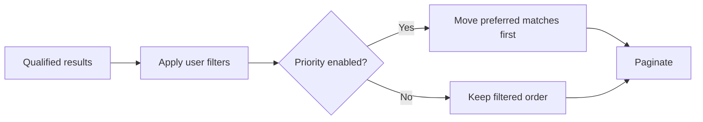

# PR illustration examples

These are illustrative mechanics, not application facts or ready-made PR text.
Choose and adapt only the views that explain the actual change; do not include
this whole catalogue or copy its behavior without verifying it.

### Responsibility split: what moved, and what stayed?

One component no longer owns both delivery mechanics and workflow effects.

```text
BEFORE                         AFTER
Sender                         Sender
├─ delivery + retries          ├─ delivery + retries (unchanged)
└─ workflow completion         └─ completion → WorkflowLifecycle
```

### User journey: where does the person enter and return?

After completing one item, return to the same list rather than ending the journey.

```text
Request list → select item → complete action → Done → same list
                                                     ├─ items remain → continue
                                                     └─ none remain  → finished
```

### Routing and convergence: what selects the owner?

Explicit request type chooses the policy; both paths retain one response contract.

```text
Verified request + explicit type
              ├─ Standard → StandardResolver ─┐
              └─ Partner  → PartnerResolver ─┴→ Context → API response
```

### Failure and recovery: what survives, and what repeats?

Persist the accepted handoff before delivery so a transport retry does not create
another request.

```text
Accept request → save receipt → deliver receipt ID
                                 ├─ succeeds → handed off
                                 └─ fails    → retry same ID
                                               saved receipt remains
```

Include the failure branch when it explains a consequential contract—not every
possible exception. A larger decision pipeline may be clearer in Mermaid:



### Concrete input/output: what does the algorithm actually do?

Priority changes ordering, not membership or eligibility.

```text
Filtered order:           [A, B, Preferred, C]
Priority ON, first 2:      [Preferred, A]       total = 4
Priority OFF, first 2:     [A, B]               total = 4
Filter removes Preferred: [A, B, C]            priority cannot add it back
```

This can complement a pipeline diagram: the diagram locates the operation;
the example demonstrates its effect.

### Action/outcome table: which differences should readers compare?

Use aligned rows when the reader needs to scan how several actions differ.

| Action | Priority | Filters |
| --- | --- | --- |
| Open default view | On | Defaults |
| Edit a filter | Off | User selection |
| Clear | On | Reset to defaults |

A lone rule such as “missing identity rejects the request” needs no table.

### Delivery boundary: what is connected now versus merely available?

Show new capability separately from the existing user path so reviewers do not
mistake an API addition for a launched feature.

```text
CONNECTED: Existing screen → new command → existing workflow
API ONLY:  New client type → new command → new lifecycle
                            No screen or entry link yet
```

Use a screenshot or recording instead when the important difference is visual
layout or interaction; label what it demonstrates and any unverified effects.
