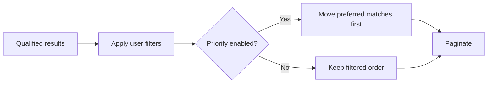

# Open PR

Help an unfamiliar reviewer quickly see **the problem → the change → the proof**.
Optimize for time to understanding, not word count or visual formatting alone.
Lead with the reason, then choose the clearest way to explain the change: a
journey, responsibility split, decision flow, concrete example or before/after.
Use implementation names where they help the reader follow the real system.
Do not make reviewers reconstruct the story from rules, caveats or test inventories.

## Create or refresh

When asked to create or refine a PR, update the actual PR unless the user requests
a preview. Editing this skill or discussing an example PR does not itself
authorize PR publication. Repeated PR refinements update the same description,
not duplicates or appended summaries.

1. Confirm the repository/branch and find its existing PR. Read the title, body, base and draft/ready state, plus the repository's template and contribution guidance.
2. Inspect the current diff against the PR base and connected code needed to verify behavior. Distinguish local work from published changes; do not describe unpublished work as delivered.
3. Write the title and description using the guidance below and the repository's required headings. Keep an existing title if it still fits. Preserve valid human context, links, required fields and material caveats; replace stale claims and duplicated explanation throughout the body.
4. Check the draft, then update the existing PR or create a **draft** through the repository's normal CLI flow. Preserve an existing PR's base, draft/ready state and unrelated metadata. Do not commit, push or change implementation solely to refine its description. If the description already fits the current diff, leave it unchanged.
5. Read back the actual saved title/body and verify metadata is unchanged except as intended. Return the PR link and a brief account of the refinement.

## Titles: name the delivery

- Name a concrete action and outcome or changed component, recognizable in a PR list without opening the body. Preserve required issue prefixes and repository conventions.
- Prefer **add, fix, remove, keep, route, extract** over vague “improvements,” “hardening,” or “enhancements.” Drop promotional adjectives such as “robust” or “seamless.” Use necessary domain terms, not unexplained internal shorthand.
- Name what this PR delivers, not the larger initiative or future capability: **“Retry failed file uploads”**, not “Robust upload workflow improvements.”

## Description: context, change, proof

Use the repository's headings; this is a reading order, not extra mandatory sections.

- **Set the scene.** Briefly explain the prior problem and why the change is needed, without requiring a ticket read. Put motivation before implementation names or stack position; skip project history and repeated TL;DRs.
- **Show the delta.** Explain what a user or system did before, what it does now and why the difference matters. A list of new rules is not an explanation of the change. Organize around behavior, not files or commits; label future work as future.
- **Let the form carry the explanation.** Use an illustration when relationships, ordering or behavior become easier to see than to describe. Use prose for the reason and consequential boundaries, not a second narration of the visual. If a sentence is clearer, use the sentence.
- **Keep detail scannable.** Give each sentence or bullet one job. Cut repeated summaries, jargon, unchanged-behavior inventories and implementation detail the diff already explains. Keep essential compatibility and permission boundaries without burying the central change.
- **State important boundaries once.** Keep consequential privacy, authorization, compatibility, failure, rollout and scope limits where they help judge the change. Skip inventories of untouched areas and generic safety boilerplate. Link detailed setup or rationale, but keep essential restrictions in the PR itself.
- **Keep verification current and factual.** Use brief bullets for checks and what they establish, not a test-results ledger. Separate completed checks, suggested manual steps, and material gaps. Consolidate re-runs rather than accumulating test receipts; retain older evidence only when its scope still matters, clearly qualified. Never invent fixtures, results, live-service verification or full-suite/CI certification. Never include credentials, PHI or client identifiers.

## Illustrations: choose the view that explains

- **Start with the reviewer’s question.** Who owns what? How does a person move through this flow? Where does a decision happen? What result changes for the same input? Choose the view that answers the important question, not a prescribed diagram type.
- **Match the shape to the subject.** Before/after for a changed boundary; a journey for entry and return; a tree for responsibilities; a flowchart for decisions and handoffs; a concrete input/output example for an algorithm; screenshots for visible UI behavior. Plain text and Mermaid are both useful—choose whichever is easier to read.
- **Use tables when scanning across rows helps.** Alternatives, actions and outcomes, or checks and evidence may benefit from aligned columns. A tiny rule may be clearer in a sentence. Long prose cells may be clearer as a flow or bullets. Judge the reading effort, not the presence of a grid; do not replace a table with equivalent ASCII boxes.
- **Allow complementary views.** A system flow can explain where a rule applies while a concrete example shows what it does. Add another view only when it answers a different consequential question. Do not prescribe one visual per PR or force every change into before/after.
- **Make each view earn its space.** Use concrete labels and enough context to follow the relationships. Remove repeated narration, decorative arrows and unrelated branches. Aim for less reading without removing the details that make a complicated change understandable.
- **Ground every claim.** Verify actors, transitions and outcomes against the diff and connected code. Do not invent a failure to motivate the change or imply that a presentation fixture proves backend behavior. Keep test evidence in the testing section.

## Example formats

These are illustrative mechanics, not application facts or ready-made PR text.
Choose and adapt only the views that explain the actual change; do not include
this whole catalogue or copy its behavior without verifying it.

### Responsibility split: what moved, and what stayed?

One component no longer owns both delivery mechanics and workflow effects.

```text
BEFORE                         AFTER
Sender                         Sender
├─ delivery + retries          ├─ delivery + retries (unchanged)
└─ workflow completion         └─ completion → WorkflowLifecycle
```

### User journey: where does the person enter and return?

After completing one item, return to the same list rather than ending the journey.

```text
Request list → select item → complete action → Done → same list
                                                     ├─ items remain → continue
                                                     └─ none remain  → finished
```

### Routing and convergence: what selects the owner?

Explicit request type chooses the policy; both paths retain one response contract.

```text
Verified request + explicit type
              ├─ Standard → StandardResolver ─┐
              └─ Partner  → PartnerResolver ─┴→ Context → API response
```

### Failure and recovery: what survives, and what repeats?

Persist the accepted handoff before delivery so a transport retry does not create
another request.

```text
Accept request → save receipt → deliver receipt ID
                                 ├─ succeeds → handed off
                                 └─ fails    → retry same ID
                                               saved receipt remains
```

Include the failure branch when it explains a consequential contract—not every
possible exception. A larger decision pipeline may be clearer in Mermaid:



### Concrete input/output: what does the algorithm actually do?

Priority changes ordering, not membership or eligibility.

```text
Filtered order:           [A, B, Preferred, C]
Priority ON, first 2:      [Preferred, A]       total = 4
Priority OFF, first 2:     [A, B]               total = 4
Filter removes Preferred: [A, B, C]            priority cannot add it back
```

This can complement a pipeline diagram: the diagram locates the operation;
the example demonstrates its effect.

### Action/outcome table: which differences should readers compare?

Use aligned rows when the reader needs to scan how several actions differ.

| Action | Priority | Filters |
| --- | --- | --- |
| Open default view | On | Defaults |
| Edit a filter | Off | User selection |
| Clear | On | Reset to defaults |

A lone rule such as “missing identity rejects the request” needs no table.

### Delivery boundary: what is connected now versus merely available?

Show new capability separately from the existing user path so reviewers do not
mistake an API addition for a launched feature.

```text
CONNECTED: Existing screen → new command → existing workflow
API ONLY:  New client type → new command → new lifecycle
                            No screen or entry link yet
```

Use a screenshot or recording instead when the important difference is visual
layout or interaction; label what it demonstrates and any unverified effects.

## Final check

- Can an unfamiliar reviewer quickly say what changed and why without reconstructing it from the diff or testing section?
- Does each illustration answer a useful reviewer question? Is a journey, responsibility view, example or sentence clearer for this change?
- Does each table make scanning easier? Do complementary views add understanding rather than repeat it? Can removing a grid, paragraph or caveat reduce effort without hiding a material boundary?
- Are current versus future behavior, required template fields, testing claims and material boundaries accurate?
- Is publication within the user's permissions, and does the saved PR preserve the intended metadata?

Saved-body equality confirms the update—not its explanatory quality. Judge both.
