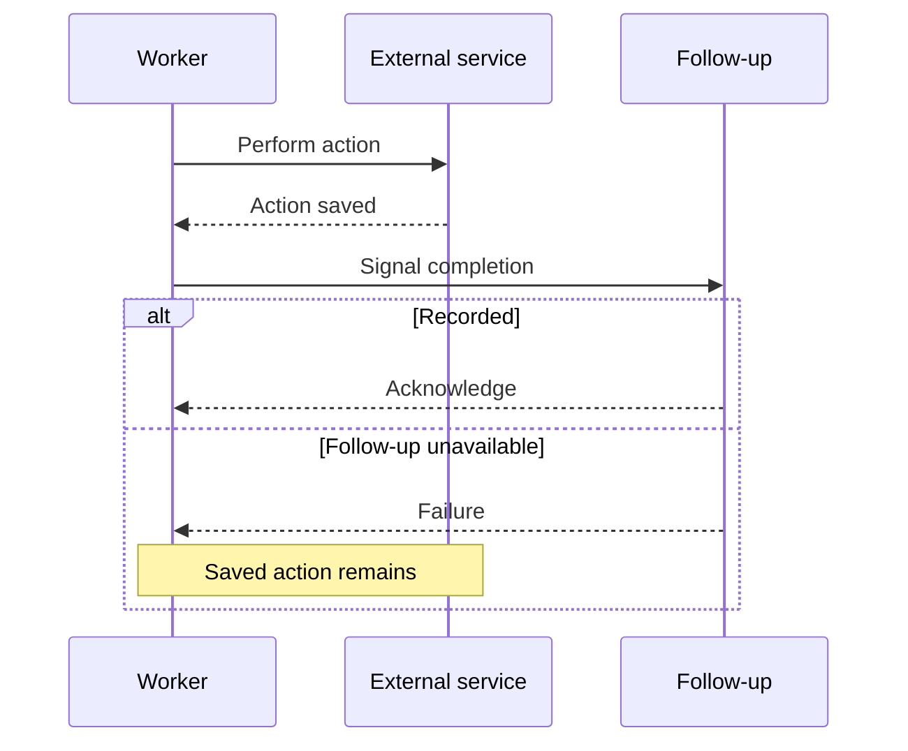

# Illustration examples

These are hypothetical patterns, not application facts or ready-made output. Choose only the views that answer the reader's question; verify behavior against the actual sources.

## Ownership: what moved, and what stayed?

Use a small before/after when the important change is responsibility:

```text
BEFORE                         AFTER
Sender                         Sender
├─ delivery + retries          ├─ delivery + retries (unchanged)
└─ workflow completion         └─ completion → WorkflowLifecycle
```

Distinguish a connected user path from an API-only capability; a new owner is not proof that callers use it.

## Partial success: what remains when a later step fails?

Use a sequence when message order between actors matters. For one action's outcomes, a short indented tree may be clearer:



An overall failure does not mean nothing happened. Explain what remains and how retries handle it; don't imply rollback, automatic repair or exactly-once behavior without source evidence.

## Input/output: what does the algorithm change?

Concrete values can show that priority changes order, not membership:

```text
Filtered order:           [A, B, Preferred, C]
Priority ON, first 2:     [Preferred, A]       total = 4
Priority OFF, first 2:    [A, B]               total = 4
Filter removes Preferred: priority cannot add it back
```

Use a decision flowchart instead when the reader needs to locate branches or loops; don't add both views unless they answer different questions.

## State meanings: what is recorded, and what does it prove?

For a hypothetical export request:

| State | Meaning | Recorded time |
| --- | --- | --- |
| `queued` | Accepted, waiting for processing | `queued_at` |
| `canceled` | Canceled before processing | `canceled_at` |
| `completed` | Processing finished; does not establish delivery to a recipient | `completed_at` |

Keep independent rules, such as one queued request per account, beside the table. Use a state diagram when transitions—not state meanings—are the question.

## Time boundaries: what happens at the cutoff?

For a hypothetical UTC window that includes its start and excludes its end:

```text
10:00                         10:15
start (included) ------------ end (excluded)

09:59:59 → outside
10:00:00 → inside
10:14:59 → inside
10:15:00 → outside
```

Show equality explicitly when it matters; verify the actual timezone, precision and inclusion rules rather than assuming this example's window semantics.
